# Nightshift engineering handbook

How Nightshift is built. Audience: the orchestrator (the main Claude Code session) and every builder agent. The product spec is `BUILD_SPEC.md`; the task-level plans are in `docs/superpowers/plans/`. This file governs process. Where the spec still says "slice", "build laptop gate" or "run pytest locally", read it as "milestone", "CI gate" and "commit, push, CI". The mapping is in section 3.

Every rule below is checkable by reading the repo, the CI log or the diagnostics bundle. A rule that cannot be checked is not a rule and does not belong here.

---

## 1. Product and non-negotiables

**Product in one line.** Nightshift is a Windows one-click bundle that turns one RTX GPU PC (16 GB) into an overnight YouTube story studio: it writes an original story, renders a long-form video first, then cuts it into Shorts, with no cloud account and no paid AI keys on the target machine.

| # | Non-negotiable | How it is checked |
|---|---|---|
| 1 | Models and large binaries are never bundled or committed; the installer downloads them from pinned sources (spec §0.1). | The `bundle` job inspects the zip: fail if it holds `.venv`, `*.gguf`, `*.exe`, `*.onnx`, `*.safetensors` or exceeds 25 MB. |
| 2 | Everything is pinned in `manifest.json` (version, URL, SHA256) (spec §0.2). | `tools/resolve_manifest.py --check` in the gate; no `null` sha256 except `bins.qwentts` when documented. |
| 3 | Contracts are frozen per milestone; changes go through `contracts/CHANGE_REQUESTS.md` (spec §0.3). | Section 4. `git diff contracts-m<N>..HEAD -- contracts ns_common` shows only orchestrator commits. |
| 4 | Exclusive ownership: a builder touches only its component's paths (spec §0.4). | Commit scope `cN` vs the path table in section 2; `dev/check_scope.py` (written in plan `m0-c10-ci-bundle.md`) fails CI on a violation. |
| 5 | Verify, don't assume: every install step has `check()`, `run()`, `verify()` (spec §0.5). | Wizard step base class requires all three; a unit test iterates every step. |
| 6 | Everything is idempotent and resumable; a job resumes from `stage_state.json` (spec §0.6). | Each stage has a "run twice, second run is a no-op" test; the wizard has a "kill at step 3, resume" test. |
| 7 | Everything is visible: visible terminal, JSONL logs per spec §15.11 (spec §0.7). | `NsLogger` is the only logger; a hygiene test bans `print(` outside CLI entry points. |
| 8 | One GPU tenant at a time (`llama`, `tts` or `whisper`), enforced by the supervisor (spec §0.8). | Supervisor test against a stub service: two concurrent acquirers serialize. |
| 9 | No hidden network at runtime except the stock-footage APIs (spec §0.9). | Hygiene test: HTTP client imports only in the allow-list in section 8. |
| 10 | YouTube safety is code, not a feature: the policy gate enforces spec §18 (spec §0.10). | Seeded negative fixtures must fail with the right `NS-E6xx` (M2 gate). |
| 11 | Real-hardware gates: nothing hardware-dependent is done until `ns verify` on the partner PC reports it (spec §0.11). | `verify-report.json` returned in the diagnostics zip. |
| 12 | Honest reporting: benchmarks and gate results are JSON in `logs\` and are quoted, not paraphrased (spec §0.12). | Reports quote file contents; every "green" claim carries a CI run URL. |
| 13 | **Nothing executes on the authoring laptop.** No Python, pip, uv, pytest, ruff, pyright, installers, models or services. The laptop edits files and runs git and `gh`. | No `.venv` in the working tree; builder reports contain no local test output. |
| 14 | **Tests run in GitHub Actions on `windows-latest`.** CI is the only authority on green. | Every completion claim cites a run URL with conclusion `success`. |
| 15 | **The GPU target is reached only through the shipped bundle.** No remote access, no manual file copies; code goes out as `Nightshift-<ver>.zip` and evidence comes back as the diagnostics zip. | Section 10. |

---

## 2. Architecture

### 2.1 Components

| ID | Component | Single responsibility | Package / paths (owned) | Depends on | Fake for tests |
|---|---|---|---|---|---|
| C1 | Installer | Take a bare Windows PC to a verified Nightshift install, resumably. | `INSTALL.cmd`, `UNINSTALL.cmd`, `installer/` (stage1.ps1, stage2/wizard.py, steps), `launchers/`, `OPERATOR.md` | C3; calls the C2 CLI (`ns tune`, `ns verify`) | `stage1.ps1 -DryRun`, `wizard.py --simulate-downloads`, fixture `answers.json`, fake `ns` on PATH |
| C2 | Runtime / supervisor | Start, stop, health-check and lock model services; own the GPU lock, Job Object cleanup, tune, verify, doctor, update and the scheduled task. | `ns_supervisor/`, `opencode/` | C3 | Stub HTTP service standing in for llama-server; `DevAcquirer` |
| C3 | `ns_common` + contracts | Shared library and every cross-component contract: names, paths, models, schemas, SQL, error codes, clients, fakes, manifest. | `ns_common/`, `contracts/`, `manifest.json`, `tools/` | none (leaf) | Defines the fakes in section 4 |
| C4 | `ns_tts` | Serve text-to-speech over the spec §15.4 HTTP API behind an `Engine` protocol. | `ns_tts/` | C3 | `FakeEngine` (tone burst per word); `NS_TTS_FAKE=1` |
| C5 | Story text | Prompts, exemplars, validators, word budgets, critic loop, calibration. | `ns_studio/text/`, `ns_studio/prompts/`, `ns_studio/exemplars/`, `ns_studio/calibrate/` | C3 | `FakeLlm` with `tests/fixtures/llm/<prompt>.json`; `FakeEmbed` |
| C6 | Media | Voice stage, captions and alignment, clip sources and cache, render, QC, outbox, thumbnails. | `ns_studio/media/`, `ns_studio/presets/` (except `clip_templates.yaml`) | C3 (ffmpeg, `Tts` client); C4 over HTTP at runtime | `FakeTts`, `FakeTranscriber`, `FakeClipSource`, real FFmpeg with `libx264 -preset ultrafast` |
| C7 | Studio core | Orchestrator, stage registry, job context, CLI, channels, variation engine, policy gate, cadence, review, learn, status. | `ns_studio/{context,stages,orchestrator,cli}.py`, `ns_studio/channels/`, `ns_studio/variation/`, `ns_studio/policy/`, `ns_studio/learn/` | C3, C5, C6; C2 over HTTP | `build_services(runtime, fake={...})`, `studio run --fake-services` |
| C8 | Clipper | Turn a user-owned long video into vertical clips: import, transcribe, select, detect, layout, cut. | `ns_studio/clipper/`, `ns_studio/presets/clip_templates.yaml` | C3, C5 (prompt loader), C6 (captions, render, QC, outbox), C7 (stage registry) | `FakeTranscriber` sidecar mode; synthetic `testsrc2` fixture with a drawn facecam rectangle |
| C9 | Dashboard | Local web UI and API on 127.0.0.1:8100 over the same job and DB layer. | `ns_dashboard/` (api, jobs worker, `static/`) | C3, C7, C8; C2 over HTTP | FastAPI `TestClient` with a fake job worker |
| C10 | CI + delivery | CI workflow, gate scripts, bundle build, release, repo hygiene checks. | `.github/`, `dev/`, `CHANGELOG.md` | C3 (version); packages the rest | `-DryRun` of `make_bundle.ps1` in a temp directory |

Tests belong to the component whose code they test (`tests/test_<module>.py`); `tests/fixtures/<area>/` follows the same owner. `tests/conftest.py`, `contracts/`, `ns_common/`, `pyproject.toml`, `uv.lock` and `manifest.json` belong to the orchestrator.

### 2.2 Dependency diagram

Solid arrows are Python imports ("depends on"). Dotted arrows are runtime calls over HTTP or the CLI; they never appear as imports. The import graph is acyclic; `tests/test_hygiene.py` fails when a package imports upward.

```mermaid
graph TD
  C3["C3 ns_common + contracts (leaf)"]
  C1["C1 Installer"] --> C3
  C1 -. "ns tune / ns verify" .-> C2["C2 Runtime / supervisor"]
  C2 --> C3
  C4["C4 ns_tts"] --> C3
  C5["C5 Story text"] --> C3
  C6["C6 Media"] --> C3
  C6 -. "HTTP :8091" .-> C4
  C7["C7 Studio core"] --> C3
  C7 --> C5
  C7 --> C6
  C7 -. "HTTP :8099 acquire/release" .-> C2
  C8["C8 Clipper"] --> C3
  C8 --> C5
  C8 --> C6
  C8 --> C7
  C9["C9 Dashboard"] --> C3
  C9 --> C7
  C9 --> C8
  C9 -. "HTTP :8099" .-> C2
  C10["C10 CI + delivery"] --> C3
  C10 -. "packages" .-> C1
```



Rules the diagram encodes:
- `ns_common` imports nothing from any other Nightshift package.
- C5 and C6 never import each other; C7 composes them. C8 reuses C6 code (renderer, captions, QC, outbox) and never copies it.
- Anything heavy (llama-server, qwentts, torch, faster-whisper, spaCy models, OpenCV) is reached only through a Protocol from C3 or an `Engine` / `Transcriber` in the owning component, with lazy imports so every module imports cleanly in CI.

---

## 3. Milestones

A milestone means: code complete, tests green in GitHub Actions on a Windows runner with fake models and real FFmpeg, bundle published. Nothing runs on the authoring laptop. The first real execution of every milestone happens on the partner's GPU PC through the shipped bundle, and its `verify-report.json` closes the milestone.

Spec §12 slices map onto milestones as follows. The spec's slice gates become CI gates. Its "first run on the work machine" (Slice 9) is the partner loop of section 10 and repeats at every milestone.

| Spec slices | Milestone |
|---|---|
| 0 Foundations, 5 Runtime (supervisor, verify, doctor), 7 Installer (core) | M0 |
| 1 One Short | M1 |
| 2 Master-first, 3 Safety and growth, scheduled task from 5 | M2 |
| 4 Clipper, 6 Dashboard | M3 |
| `ns tune` from 5, spec §16.5 calibration, 8 Nightshift Code, operator docs | M4 |

### M0 "Provisioning (installer + runtime)"
- **Scope:** C3 contracts v1 (all spec §15.6 schemas needed by M0 and M1, SQL schema, error codes, clients and fakes, manifest with verified pins). C10 CI, gate script, `make_bundle.ps1`, release job. C1 machine check (spec §1.2 table, `NS-E1xx`), downloader (HEAD, Range resume, SHA256, `models_source` mode), venv creation, `answers.json` handling. C2 supervisor (acquire, release, status, shutdown, GPU lock, Job Object, idle unload), service definitions for `llama`, `embed`, `tts`, whisper load check, `ns verify`, `ns doctor --bundle`, `ns stop`.
- **Exit criteria (CI):** `dev/gate_m0.py` green on `windows-latest`: pytest, ruff, pyright, manifest check, fakes validate against schemas, FFmpeg test clip, `stage1.ps1 -DryRun`, wizard `--simulate-downloads` with kill-and-resume, stub-service supervisor tests, bundle content check.
- **Exit criteria (partner):** the partner installs v0.1, all services start (`llama`, `embed`, `tts` healthy, whisper loads on CUDA) and the returned `verify-report.json` is green. A red item starts a fix pass (section 10); it is not an exit.
- **Release tag:** `contracts-m0` (cut at the end of the C3 plan; replaces `contracts-s1`), then `v0.1.0`.
- **Partner receives:** `Nightshift-0.1.0.zip`, `.sha256`, `answers.json`, `OPERATOR.md`, optional `models\` folder. Nothing that produces a video yet.

### M1 "Shorts pipeline"
- **Scope:** C4 TTS service (engines, voice library, chunking, API). C5 shorts-only text stages (ideas to visual plan), validators, exemplars. C6 voice, captions with script alignment, clip sources and cache, vertical render, QC, outbox and upload sheet. C7 minimal CLI (`studio run --format shorts_only`, `studio channel add`, `studio voice`), orchestrator, `--fake-services`. C1 adds config writing, keyring and the smoke step (NVENC, TTS, whisper, LLM).
- **Exit criteria (CI):** `dev/gate_m1.py`: `studio run --fake-services --format shorts_only --count 3` yields 3 real MP4s with burned captions, QC passing (duration, loudness, drift, file opens, aspect) and upload sheets valid against schema.
- **Exit criteria (partner):** `studio run --format shorts_only --count 1` on the partner PC produces a Short in the Outbox, and `verify-report.json` shows the TTS, whisper and NVENC results.
- **Release tag:** `v0.2.0`.
- **Partner receives:** `Nightshift-0.2.0.zip` (applied with the Update shortcut) and a one-page "make your first Short" note in `OPERATOR.md`.

### M2 "Long-form nightly pipeline"
- **Scope:** master-first pipeline (long plan, chapter drafts, critique and revise, continuity, expansion loop, long SEO, Shorts selection and timing, landscape render, chapter cards, mid-roll suggestions, thumbnails, derived Shorts). Policy gate (text and final, all spec §18.8 checks). Variation engine and combo ledger. Cadence governor. `studio review`, `status`, `pause`, `resume`, `mark-uploaded`, `learn --import`. Scheduler: C2 registers the `Nightshift Daily` task (`WakeToRun`, `StartWhenAvailable`), C7 provides `studio run --daily`. C1 adds shortcuts and the summary step.
- **Exit criteria (CI):** `dev/gate_m2.py`: fake master job with `long_minutes: [9, 10]` exercises the floor and expansion loop; `chapters.json` timestamps match ffprobe; mid-roll suggestions respect the 2-minute rule; 4 Shorts cut and rendered; seeded negative fixtures (true-story claim, real name, duplicate story, music track) fail with the right `NS-E6xx`; a sample analytics CSV reweights pools.
- **Exit criteria (partner):** one unattended night yields a long-form master of at least 8:30 plus its Shorts in the Outbox, with the nightly report in `logs\`.
- **Release tag:** `contracts-m2` if schemas were added, then `v0.3.0`.
- **Partner receives:** `Nightshift-0.3.0.zip`, the review checklist (spec §18.10, §18.11), and a request to leave the PC asleep with the task armed for one night.

### M3 "Clipper + Dashboard"
- **Scope:** C8 and C9 are built in parallel by separate builders on disjoint paths (C9 uses a fake job worker until C8 lands). C8: import, transcribe, select, detect, templates, cut, clip SEO, `studio clip`. C9: API per spec §20.3, static UI ported from `docs/superpowers/mockups/dashboard.html`, job worker, range streaming, chunked upload. C2 adds the `dashboard` service entry and `/events`. C1 adds the Dashboard shortcut.
- **Exit criteria (CI):** `dev/gate_m3.py`: the clipper fixture yields at least 2 clips at 1080x1920 with the facecam found within 5 % of its true position, QC and sheets valid; every dashboard route passes under `TestClient`; a fake clip job started through `/api/jobs/clip` finishes and appears in the review queue; approve and reject write `outputs.status`.
- **Exit criteria (partner):** the partner drops a video on the Clipper page and reviews the resulting clips in the Dashboard.
- **Release tag:** `contracts-m3` (adds `transcript`, `clip_plan`, `clip_layout`, `clip_template`; no `dashboard_job` schema, a dashboard job is a `dashboard_jobs` row, see BUILD_SPEC.md 15.6), then `v0.4.0`.
- **Partner receives:** `Nightshift-0.4.0.zip`.

### M4 "Release hardening"
- **Scope:** `ns tune` sweep, `studio calibrate` with the human scoring loop and refusal rate, `ns update` with rollback, `ns backup` and `ns restore`, `UNINSTALL.cmd`, toast notifications, `OPERATOR.md` finalized, optional Nightshift Code (OpenCode pin, `opencode.json`, launcher), performance work against spec §14.6 using data measured on the partner PC.
- **Exit criteria (CI):** `dev/gate_m4.py`: update and rollback in a temp copy, uninstall idempotence, tune sweep against the stub service, all earlier gates still green.
- **Exit criteria (partner):** `verify-report.json` meets the spec §14.6 targets or records measured misses with a decision; calibration scores returned; the week-8 go/no-go (spec §18.12) is scheduled.
- **Release tag:** `contracts-m4`, then `v1.0.0`.
- **Partner receives:** `Nightshift-1.0.0.zip` and the final `OPERATOR.md`.

### Milestone x component matrix

`B` = built in this milestone. `+` = extended. `-` = untouched (bug fixes only).

| Component | M0 | M1 | M2 | M3 | M4 |
|---|---|---|---|---|---|
| C1 Installer | B: machine check, downloader, venvs, answers | +: configs, keyring, smoke | +: scheduled-task step, shortcuts, summary | +: Dashboard shortcut | +: uninstall, update, Code option |
| C2 Runtime | B: services, lock, `ns verify`, doctor | - | +: scheduled task | +: `dashboard` service, `/events` | +: `ns tune`, update, backup, toasts |
| C3 `ns_common` + contracts | B: contracts v1, fakes, manifest | - | + (CRs only) | + (clipper, dashboard schemas) | + (CRs only) |
| C4 `ns_tts` | - | B | - | - | + (perf, voice backup) |
| C5 Story text | - | B: shorts-only | +: long-form prompts, Shorts select | +: `clip_select`, `clip_seo` prompts | +: calibration |
| C6 Media | - | B: voice, captions, clips, vertical render, QC, outbox | +: landscape, chapter cards, thumbnails | - (reused by C8) | + (perf) |
| C7 Studio core | - | B: orchestrator, minimal CLI | +: master-first, policy, variation, cadence, review, learn | + (dashboard hooks) | + |
| C8 Clipper | - | - | - | B | + |
| C9 Dashboard | - | - | - | B | + |
| C10 CI + delivery | B: CI, bundle, release | +: gate_m1 | +: gate_m2 | +: gate_m3 | +: gate_m4, v1.0.0 |

---

## 4. Contracts discipline

**What a contract is here.** Anything two components must agree on:

| Kind | Where it lives | Source of truth |
|---|---|---|
| Names (product, env var, packages, services, aliases, keyring keys) | spec §15.1 | `ns_common/paths.py`, `ns_common/models.py` |
| Paths under `NIGHTSHIFT_HOME` and the job directory layout | spec §15.2, §15.8 | `ns_common/paths.py` (`Paths`) |
| Ports and the supervisor, TTS and embed HTTP APIs | spec §15.3-15.5 | `contracts/CONTRACTS.md` plus client code in `ns_common` |
| JSON schemas | `contracts/schemas/*.schema.json` | Exported from the pydantic models in `ns_common/models.py`; a test fails if the files drift from the models |
| SQL schema | `contracts/schema.sql` | Applied by `ns_common/db.py`; a test migrates an empty DB |
| Error codes | `contracts/errors.json` | `ns_common/errors.py`; a test fails if any `NS-E`/`NS-W` literal in source is missing from the file |
| CLI surface (`ns`, `studio`) | spec §15.9 | `contracts/CONTRACTS.md`; CLI tests assert `--help` lists the commands |
| Prompt front-matter (`version`, `thinking`, `schema`) | spec §15.13 | `ns_studio/text/prompts.py` loader rejects files without it |
| Policy lists | `contracts/policy/*` | Orchestrator-owned data files |

**Freeze tags.** `contracts-m<N>` is cut by the orchestrator, on a green CI commit, before milestone N's builders start. The tag freezes everything they may import from `ns_common/` and `contracts/`. Tags are cumulative: `contracts-m0` is contracts v1 (all spec §15.6 schemas needed by M0 and M1); `m2`, `m3` and `m4` add only what that milestone needs. Builders pin their work to the tag named in their plan header.

**Changing a frozen contract.** Only through `contracts/CHANGE_REQUESTS.md`, entry format `CR-<n>: <short title>` with requester component, what changes, who consumes it, migration, and status (`open | accepted | rejected | done`). A builder who needs a change stops that task, states the request in its final report, and continues with other tasks. The orchestrator decides, edits, re-tags if accepted, and amends the consumers' plans.

**Who may edit what.** `ns_common/` and `contracts/` (plus `manifest.json`, `pyproject.toml`, `uv.lock`, `tests/conftest.py`): the orchestrator only. A builder commit touching those paths is reverted. Enforcement: commit scope `cN` plus `dev/check_scope.py`.

**Every heavy dependency sits behind a Protocol with a fake that writes real files.** A fake that returns a canned string does not count: it must produce the same artifact type as the real one so the next stage runs on it.

| Dependency | Protocol | Fake (spec §1.1) | What the fake writes |
|---|---|---|---|
| LLM | `Llm.complete_json` / `complete_text` (`ns_common/llm_client.py`) | `FakeLlm` | Fixture JSON per prompt name, validated against the same schema |
| TTS client | `Tts.speak` / `speak_batch` (`ns_common/tts_client.py`) | `FakeTts` | 24 kHz mono WAV, length `words/wpm`, one tone burst per word |
| TTS server engine | `Engine` (`ns_tts/engine.py`) | `FakeEngine` | Same tone-burst audio, server side |
| Whisper | `Transcriber.words(wav)` | `FakeTranscriber` | Script words spread evenly over the WAV duration; sidecar-transcript mode for the Clipper |
| Stock clips | `ClipSource.search` / `download` | `FakeClipSource` | FFmpeg `testsrc2` / `color` clips tagged with the keywords |
| Embeddings | `Embed.embed` (`ns_common/embed_client.py`) | `FakeEmbed` | Deterministic hashed bag-of-words vectors, cosine-meaningful |
| GPU lock | `Acquirer.acquire` / `release` (`ns_common/acquire.py`) | `DevAcquirer` | Fixed endpoints, no locking |
| Encoder | `runtime.video.encoder` | `libx264 -preset ultrafast` | Real MP4 |
| Supervisor child | service table | Stub HTTP server | `/health` and a minimal completion endpoint |

`studio run --fake-services` wires all of them at once; `--fake-services=llm,tts,whisper,embed` fakes a subset.

---

## 5. Workflow for builders

**Superseded since 2026-11-10 by the block process.** Work moves in blocks as `OPERATING.md` says (a file kept outside the repository, on the build machine), and `BUILDER_RULES.md` (also outside the repository) says how one item is built. A builder builds, tests and commits locally in its worktree and never pushes or opens a pull request. The Head integrates a block, and CI on the block's one pull request is the verification of record. The commit trailer names the model that wrote the commit. Where the text below disagrees, those two files win; the rest of this section is kept as it was.

**Who builds.** Builders are Sonnet agents at effort `high`. Opus only for tasks a plan marks `opus` (prompt design, policy logic, orchestrator design). Haiku for mechanical sweeps. **Never run an agent on Fable**: no `fork` subagents, always an explicit `model`. The orchestrator is the only session that edits `ns_common/` and `contracts/`.

**Loop per task:**
1. Read the plan task and the spec sections it cites. Do not read other components' plans.
2. Write the tests first.
3. Write the code until the tests would pass on reading (no local execution; section 1 rule 13).
4. Commit per task as `<type>(<cN>): <subject>`, `type` in `feat|fix|test|chore|docs|refactor`, a body of one to three lines, then the trailers exactly:
   ```
   Co-Authored-By: Claude Fable 5.1 <noreply@anthropic.com>
   Claude-Session: https://claude.ai/code/session_016qaaopKpuHaLfNntdGyAbq
   ```
5. Push after every 2-3 tasks (`git pull --rebase` first). Never `--force`, never `--no-verify`.
6. `gh run watch` on the pushed commit. On failure: `gh run view --log-failed`, fix, commit, push, repeat.
7. Tick the plan checkboxes of the finished task in your own plan file (the only edit a builder may make under `docs/`).
8. Report: tasks done, commit SHAs, the CI run URL and its conclusion, deviations from the plan, change requests. **Never claim green without the CI URL.** A claim without a URL counts as not done.

Every "Run: pytest ..." step in a plan means "commit, push, check CI". A "FAIL expected" step (red test first) is satisfied by reading: the test must reference a symbol that does not exist yet; it is not pushed alone.

**Ownership and parallelism.**
- One builder per component per milestone. A builder never touches another component's paths (section 2.1).
- Parallel builders commit to `main` only when their file sets are disjoint, which the path table guarantees. They `git pull --rebase` before every push. A rebase conflict means the sets were not disjoint: stop and report.
- When a task needs files outside the builder's component (for example C8 extending a C6 function), the builder works on `feat/<component>` instead, and the orchestrator merges after CI is green on the branch and the owning component's builder has reviewed the diff.
- The orchestrator merges with `git merge --no-ff`, never rebases published branches, and deletes the branch after the merge.

**Definition of Done per task** (all must hold):
1. Tests exist for the new behavior, including each error path, and pass in CI.
2. `ruff check .` and `pyright` are clean in the same CI run.
3. Every public function and class has a docstring (one line minimum; units and error codes stated where relevant).
4. Error paths raise `NsError` with a code from `contracts/errors.json`; no bare `raise Exception`.
5. Logging goes through `NsLogger`; no `print` outside CLI entry points.
6. No new dependency without a pin in `pyproject.toml` (Python) or `manifest.json` (binaries and models). A needed pin change is a change request, not a builder edit.
7. The plan checkbox is ticked and the commit message names the task number.

---

## 6. Testing strategy

Five layers; a defect should be caught by the lowest layer that can see it.

| Layer | What | Where it runs | Pass condition |
|---|---|---|---|
| 1 Unit with fakes | One module, fakes for every collaborator, `tmp_path` as `NIGHTSHIFT_HOME`, no network (`pytest-httpx`), no sleeps (clocks are injected) | CI `test` job | pytest green |
| 2 Contract tests | Every fixture and every fake output validated against `contracts/schemas`; schemas regenerated from models and diffed; `errors.json` vs source literals; `schema.sql` migrates an empty DB; prompt front-matter present | CI `test` job | pytest green |
| 3 Fake-services end to end | The real orchestrator, stages, validators, QC and outbox with fakes for LLM, TTS, whisper, clips and embed, and real FFmpeg (`libx264`) producing real MP4s; installer with `-DryRun` and `--simulate-downloads`; supervisor against the stub service | CI `gate` job | MP4 opens in ffprobe, QC checks pass, upload sheet validates |
| 4 Milestone gate | `dev/gate_m<N>.py` aggregates layers 1-3 plus milestone-specific negative fixtures and writes `logs/gate-m<N>-<date>.json` (a `GateReport`) | CI `gate` job, uploaded as artifact `gate-m<N>` | Exit 0; report quoted in the release notes |
| 5 Real hardware | `ns verify` on the partner PC measures the spec §14.6 table, exercises every wrapped item below and runs one real job; `ns doctor --bundle` returns `verify-report.json`, logs and `pip freeze` | Partner PC | Report green, or failures triaged in a fix pass |

Rules: no test depends on wall-clock timing, GPU, the real home folder or the internet; fixtures are small (MP4s are generated, not committed); every `NS-E` code raised has a test; assertions on loudness, drift and duration use the spec §7.7 limits, never looser ones.

**What cannot be tested before shipping, and how each is wrapped:**

| Untestable in CI | Wrapper | Error code | Fallback | Measured by |
|---|---|---|---|---|
| CUDA 12.8 PyTorch on Blackwell (sm_120) | Created only if `qwentts.cpp` fails; checks `torch.cuda.is_available()` and capability >= (12,0); prints the exact cu128 reinstall command | `NS-E108` | Block with fix hint | `s08_smoke`, `ns verify` |
| `qwentts.cpp` CUDA binary | Smoke test: one sentence per installed talker | `NS-W301` | Reference `qwen-tts` engine (PyTorch cu128) | `s08_smoke`, `ns verify` |
| `faster-qwen3-tts` CUDA graphs (reference path) | Engine chosen by smoke test; env override | `NS-W301` | Reference engine | `ns verify` |
| NVENC | 2-second colour-source encode with `h264_nvenc` | `NS-W401` | `libx264`, recorded in `runtime.json` | `s08_smoke` |
| llama.cpp CUDA offload and MTP speed | Start with and without `--spec-type draft-mtp`; keep MTP only if faster | `NS-W302` | Plain decoding | `ns verify`, `ns tune` |
| faster-whisper on CUDA (cuBLAS/cuDNN DLLs) | `ns_common.gpu_dlls.ensure_on_path()` before import; load test | `NS-E112` | Fix hint naming the wheels | `ns verify` |
| `ns tune` results | Sweep records every attempt; failure keeps safe defaults | `NS-W3xx` | Safe default flags in `runtime.json` | M4 `ns tune` |
| Real model output quality | Validators, critic bar, calibration, refusal-rate check | `NS-E303`, `NS-E304` | Raise bar, switch tier, two-model mode | `studio calibrate` (M4) |
| Driver, long-path registry, wake timers, disk type | Machine check table | `NS-E103`, `NS-W112`, `NS-W107`, `NS-W106` | Fix hint, pause and re-check | Installer |

---

## 7. CI and release

**Workflow `.github/workflows/ci.yml`** runs on `pull_request`, on `push` to `main` and to tags, and nightly (a pull request branch is tested by its `pull_request` run alone), on `windows-latest`, Python 3.12, FFmpeg from the composite action `.github/actions/install-ffmpeg` (H-9): the build `manifest.json` pins under `bins.ffmpeg` (the one the product itself falls back to), restored from the Actions cache or downloaded and checked against the manifest's sha256 by `dev/ci_install_ffmpeg.py`, Chocolatey only as a second source, and a final `ffmpeg -version` / `ffprobe -version` that fails the step with `FFmpeg could not be installed: <source> answered <status>` (and says `upstream outage` in the job summary when the host kept answering 5xx), so a missing FFmpeg never reaches pytest. The workflow from the foundations plan, Task 1, is a single `test` job running `ruff`, `pyright` and `pytest`; it stays as is. Plan `m0-c10-ci-bundle.md` splits and extends it:

| Job | Steps | Required |
|---|---|---|
| `lint` | `python -m ruff check .`; PSScriptAnalyzer `-Severity Error` over `*.ps1` | yes |
| `types` | `python -m pyright` (on a docs-only pull request: one step that says it is not applicable) | yes |
| `test` | gathers the six `test-shard (N/6)` jobs, each `python -m pytest` over its share of the test files (`dev/ci_shards.py`, `SHARDS`, balanced by `dev/ci_shard_weights.json` measured from real JUnit timings; includes hygiene tests), and `test-collect`; passes only when all passed and together they ran the whole unsharded collection. On a docs-only pull request (`dev/ci_changes.py`: only `docs/**`, top-level `*.md`, `contracts/CHANGE_REQUESTS.md`) it gathers `test-docs` instead, the test files that read documents, and passes only when they ran and passed. Which checks each kind of pull request shows, by name: `docs/REPO_SETTINGS.md` | yes |
| `gate` | `python dev/gate_m<current>.py`; upload `logs/gate-*.json` as an artifact | yes on `main` |
| `bundle` | On tags `v*` only: verify tag equals `pyproject` version and `ns_common.__version__`; run `dev/make_bundle.ps1`; content check (no venv, models or binaries; size < 25 MB); attach `Nightshift-<ver>.zip` and `Nightshift-<ver>.zip.sha256` to a GitHub Release with notes from `CHANGELOG.md` | on tags |

**Versioning.** SemVer. Single source: `pyproject.toml` `version`; `ns_common.__version__` must equal it (a unit test asserts this); the bundle writes `VERSION` at the zip root from the tag. Milestones map to minors (`0.1.0` M0, `0.2.0` M1, `0.3.0` M2, `0.4.0` M3, `1.0.0` M4); fix passes are patches (`0.1.1`). Tags `v*` are created by the orchestrator only, on a green `main` commit.

**The dependency lock.** `uv.lock` (repository root, in the bundle) pins every package of every extra with
its hashes; setup and `ns update` install from it (`installer/stage2/web/deplock.py`) and refuse with NS-E124
when it is missing or was not made for `pyproject.toml`. It must be made again whenever `pyproject.toml`
changes its dependencies, its extras OR its `version` (uv writes the project version into the lock, so every
release bump needs it): `python dev/lock_deps.py` on any machine with internet. The script runs `uv lock` with
the uv version `manifest.json` pins (the uv that reads the lock on the target) and downloads package metadata
only, no wheels. `python dev/lock_deps.py --check` checks without the network. CI checks every push without
uv: `tests/test_dependency_lock.py` compares the lock with `pyproject.toml` (project version, requirements,
extras) and fails with that command in its message; where the pinned uv is present the same file also runs
the product's own `uv export --locked --offline` calls against the committed lock.

**Changelog.** `CHANGELOG.md` in Keep a Changelog format. Each builder puts one line per `feat` or `fix` batch in its report; the orchestrator adds them under `## Unreleased`, and moves them under the new version heading before tagging. The `bundle` job fails when the heading for the tag is missing.

**Branch protection for a solo-orchestrator repo.** Pull requests are not required (builders push to `main` directly when file sets are disjoint). Settings: `main` forbids force-push and deletion; required status checks `lint`, `types` and `test` gate merges of `feat/*` branches; tags `v*` and `contracts-m*` are protected by a tag ruleset so only the owner creates or moves them; `contents: write` permission only in the `bundle` job; no secrets in the repo (the Drive upload is manual).

---

## 8. Code standards

| Area | Rule | Check |
|---|---|---|
| Language | Python 3.12 (`>=3.12,<3.13`); type hints on all public signatures | pyright |
| Lint | ruff with `select = ["E","F","I","B","UP"]`, line length 110 (as in `pyproject.toml`); `TID251` added to ban `subprocess` (below) | CI `lint` |
| Types | pyright `standard` over `ns_common ns_studio ns_tts ns_supervisor tools` | CI `types` |
| Data | Pydantic v2 models are the single source of truth; JSON schemas are exported, never hand-written; no untyped `dict` crosses a component boundary | Schema drift test |
| Exceptions | No bare `except:` (ruff E722). `except Exception` only to wrap into `NsError`, or to log through `NsLogger` and re-raise | ruff, review |
| Subprocess | Only through `ns_common.ffmpeg.run` (FFmpeg and ffprobe) or the supervisor (services). Exceptions, listed in ruff per-file-ignores: `installer/` (winget, nvidia-smi, uv), `ns_common/secret_file.py` (icacls on the secrets file), `tools/`, `dev/`, `tests/`. Never `shell=True` | ruff TID251, hygiene test |
| Paths | All locations come from `ns_common.paths.Paths`; no hand-built `NIGHTSHIFT_HOME` or `LOCALAPPDATA` strings outside `paths.py` and `config.py`; `pathlib` throughout | Hygiene test (grep) |
| Secrets | Pexels and Pixabay keys only in the Windows keyring (service `Nightshift`); `answers.json` is gitignored and blanked by the wizard; keys are never logged or written to `runtime.json` | Hygiene test (no key-shaped literals), log scrubbing test |
| Network | At runtime only the stock APIs (Pexels, Pixabay) and loopback. HTTP client imports appear only in `ns_common/*_client.py` (loopback), `ns_studio/media/clip_sources.py`, `installer/`, `tools/`, `ns_supervisor/` | Hygiene test (import allow-list) |
| Windows paths | Assume paths over 260 characters: `LongPathsEnabled` check (`NS-W112`), short job-directory names, a helper for `\\?\` where a tool needs it, `git config core.longpaths true` in CI | CI test with a 300-character path |
| Line endings | `.gitattributes`: LF for text, CRLF for `*.ps1` and `*.cmd` | File exists (foundations Task 1) |
| PowerShell | Every `*.ps1` begins with `Set-StrictMode -Version Latest` and `$ErrorActionPreference = 'Stop'`; ASCII only; no `Invoke-Expression`; execution-policy bypass only in `INSTALL.cmd`, for its own process | Hygiene test reads each script's head; PSScriptAnalyzer |
| Errors | Codes only from `contracts/errors.json`; message in plain English plus a fix hint | errors test |
| Logging | `NsLogger` JSONL (`ts, level, component, event, msg, data`); every stage logs `stage_start` and `stage_end` | logging test |
| Docs | Docstring on every public function and class; module docstring names the owning component id | Review, DoD item 3 |
| Imports | No heavy import at module top level (`torch`, `faster_whisper`, `spacy`, `qwen_tts`, `cv2`); only inside functions | Import-time test: import every package with those modules blocked |

---

## 9. Risk register

Likelihood (L) and impact (I): H high, M medium, L low.

| # | Risk | L | I | Mitigation | Retired at |
|---|---|---|---|---|---|
| 1 | No prebuilt Windows CUDA `qwentts.cpp` binary passes the smoke test | H | M | Manifest allows `bins.qwentts = null`; smoke test selects the reference `qwen-tts` engine (`NS-W301`) and downloads safetensors only then (+7 GB); `ns_tts` has both engines behind `Engine` | M1 (first voiced Short on the partner PC) |
| 2 | Blackwell (sm_120) needs a cu128 PyTorch; a wrong wheel breaks the fallback | M | H | Fallback venv installs from the cu128 index with pinned versions; capability check; exact reinstall command in `NS-E108`; not on the default path | M1 |
| 3 | NVENC absent or failing | L | L | 2-second NVENC probe in smoke; `libx264` fallback recorded in `runtime.json` (`NS-W401`); render code is encoder-agnostic | M1 |
| 4 | Hugging Face downloads fail or stall on slow links (about 15 GB) | H | M | HEAD for size, Range resume, `.part` files, SHA256 (`NS-E109`), 3 retries with backoff, `models_source` folder mode via Drive or USB, safe to close and re-run | M0 |
| 5 | Output quality of the 14B model is below the bar (writing, refusals on fiction) | M | H | Exemplars, hard validators, critic loop, calibration with human scores, `balanced` / `best` tiers, two-model mode if refusal rate exceeds 2 % | M4 (calibration) |
| 6 | YouTube enforcement against AI-assembled channels (inauthentic content) | M | H | Policy gate, variation engine and combo ledger, honest-metadata rules, mandatory human review, incident procedure, week-8 go/no-go | M2 (controls shipped); residual stays until go/no-go |
| 7 | faster-whisper cannot load on CUDA (cuBLAS 12 / cuDNN 9 DLLs not on PATH) | H | M | `nvidia-cublas-cu12` and `nvidia-cudnn-cu12` wheels in the studio venv; `gpu_dlls.ensure_on_path()`; load test in `ns verify` with `NS-E112` hint | M0 |
| 8 | Orphaned model processes keep VRAM after a supervisor crash (Job Object cleanup fails) | M | H | Windows Job Object with `KILL_ON_JOB_CLOSE`; tested against the stub service on `windows-latest`; `ns stop` kills by recorded pid; verify asserts idle VRAM <= 300 MB | M0 |
| 9 | Paths exceed 260 characters (model names, job directories) | M | M | `LongPathsEnabled` check and `NS-W112`; short job ids; `Paths` helpers; CI test with a long path | M0 |
| 10 | Prompt drift: edits or model swaps silently lower quality or break schemas | H | M | Front-matter `version` recorded in `metadata.prompt_versions`; a fixture per prompt validated against its schema; a prompt change needs a fixture update and, from M4, a calibration re-run | M4 |

---

## 10. Operating the partner loop

The partner runs the GPU PC. The orchestrator has no access to it. Communication is one Google Drive folder.

**Drive folder layout**

```
Nightshift-Drive/
  00-START-HERE.txt              copy of OPERATOR.md
  releases/Nightshift-<ver>.zip  and  Nightshift-<ver>.zip.sha256
  answers.json                   filled for this partner; never in git
  models/                        optional pre-downloaded files for models_source
  diagnostics/                   partner uploads nightshift-diagnostics-<date>.zip here
  feedback/                      optional: partner notes, screenshots, human scores CSV
```

The zip serves both a fresh install and `ns update`. The spec's `nightshift-app-<ver>.zip` is the same artifact; the Update shortcut's file picker filter must be `Nightshift-*.zip` (to fix in the C1/C2 plans).

**What the partner runs**
1. First install: extract the zip to `D:\NightShift`, put `answers.json` next to `INSTALL.cmd`, double-click `INSTALL.cmd`.
2. Later releases: the Update shortcut (`ns update <zip>`), which re-syncs venvs and runs `ns verify --quick`.
3. On any failure, or when asked: the Diagnostics shortcut (`ns doctor --bundle`), then upload the Desktop zip to `diagnostics/`.

**What comes back** (`nightshift-diagnostics-<date>.zip`): `logs\` (JSONL), `install_state.json`, `runtime.json`, `verify-report.json`, `nvidia-smi` output, `pip freeze` per venv, the last 3 job directories without media, and `VERSION`. No API keys, no videos, no models.

**Fix-pass procedure**
1. Download the zip. Read `verify-report.json` first, then the `NS-` codes in `logs\`, mapped through `contracts/errors.json`.
2. Classify: environment (partner PC), wrapper gap (code), model quality, or unknown. Record the finding in `docs/hardware/<date>-<ver>.md` with quoted JSON lines.
3. Reproduce in CI: add a test, fake behavior or recorded fixture that fails the same way. If it cannot be reproduced, say why in the finding and add a diagnostic to the bundle instead.
4. Fix in the owning component (a builder; the orchestrator for `ns_common`), CI green, changelog line, patch tag (`v0.1.1`), new bundle in `releases/`.
5. The partner updates, reruns `ns verify` and uploads a new bundle. A fix pass ends when the item is green in `verify-report.json`, not when CI is green.

**Continuing on the GPU machine after M0.** Once M0 is green the default stays zip-based. If the partner agrees, the codebase may also continue on the GPU PC:
- Clone the GitHub repo into `D:\NightShift` over the extracted zip (`install_state.app_path` is unchanged); `uv sync` re-syncs the venvs; `ns update` keeps `.git`, `config\` and untracked data.
- On that machine only, Claude Code may run `ns verify`, `ns tune`, real-model jobs, `dev\run_services_dev.ps1` and local pytest. This is the single exception to section 1 rule 13, and CI remains the merge authority.
- Hardware measurements, calibration CSVs and prompt experiments are committed as JSON or CSV under `docs/hardware/`; code changes still follow section 5.
- A hardware-only question that stalls CI-based work may be answered there; the finding is then fed back into fakes and tests so CI covers it next time.
