# Nightshift System Map (editable Mermaid)

Source of truth for the diagrams in `system-diagram.html`. Names are real files, modules and models from the repo (clean clone of main at 54c9d42, 2 Nov 2026, after PRs #44 to #51). Engine numbers in brackets: 1 Story, 2 Voice, 3 Ear, 4 Picture, 5 Judge, 6 Memory, 7 Conductor, 8 Face, 9 Installer. Dashed nodes are replaced by a fake in CI. The gap list is in `system-gaps.md`.

## 0. Component map

```mermaid
flowchart LR
  classDef fake stroke-dasharray: 4 3;
  subgraph LAP["Owner's laptop"]
    LAP_Claude_Code["Claude Code<br/><small>builds blind</small>"]
    LAP_repo_checkout["repo checkout<br/><small>D:\NightShift-main</small>"]
    LAP_tests_["tests/<br/><small>pytest + fakes</small>"]
    LAP_dev_["dev/<br/><small>bundle + gates</small>"]
    LAP_DEMO_cmd["DEMO.cmd<br/><small>UI demo data</small>"]
  end
  subgraph GH["GitHub"]
    GH_ci_yml["ci.yml<br/><small>lint·types·test·ui-build</small>"]
    GH_release_yml["release.yml<br/><small>on a v* tag</small>"]
    GH_build_qwentts_yml["build-qwentts.yml<br/><small>CUDA build ~45 min</small>"]
    GH_GitHub_Releases["GitHub Releases<br/><small>v0.1.0</small>"]
  end
  subgraph PC["Partner PC (RTX 16 GB)"]
    subgraph INS["installer"]
      INS_INSTALL_cmd["INSTALL.cmd (9)<br/><small>double-click</small>"]
      INS_stage1_ps1["stage1.ps1 (9)<br/><small>splash</small>"]
      INS_stage2_web["stage2/web (9)<br/><small>P1 setup server</small>"]:::fake
      INS_installer_ui["installer/ui (9)<br/><small>setup window</small>"]
      INS_wizard_py["wizard.py (9)<br/><small>P2 engine</small>"]
      INS_steps_s00_s10["steps s00-s10 (9)<br/><small>check/run/verify</small>"]
      INS_downloader["downloader (9)<br/><small>resumable·SHA256</small>"]:::fake
      INS_manifest_json["manifest.json (9)<br/><small>pinned files</small>"]
      INS_answers_json["answers.json (9)<br/><small>unattended</small>"]
    end
    subgraph WIN["Windows"]
      WIN_Task_Scheduler["Task Scheduler (7)<br/><small>Nightshift Daily</small>"]
      WIN_Desktop_shortcuts["Desktop shortcuts (8)<br/><small>.lnk files</small>"]
      WIN_Job_Object["Job Object (7)<br/><small>kill on close</small>"]
      WIN_nvidia_smi["nvidia-smi (7)<br/><small>GPU readout</small>"]
      WIN_Toasts___notes["Toasts · notes (7)<br/><small>end of run</small>"]
      WIN_WebView2_window["WebView2 window (8)<br/><small>frameless</small>"]
    end
    subgraph LCH["launchers"]
      LCH_dashboard_ps1["dashboard.ps1 (8)<br/><small>shortcut target</small>"]
      LCH_stop_all_ps1["stop-all.ps1 (7)<br/><small>quit engine</small>"]
      LCH_host_ps1["host.ps1 (8)<br/><small>WebView2 host</small>"]
      LCH_update_ps1["update.ps1 (7)<br/><small>ns update</small>"]
      LCH_diagnostics_ps1["diagnostics.ps1 (7)<br/><small>ns doctor</small>"]
      LCH_code_ps1["code.ps1 (7)<br/><small>OpenCode</small>"]
    end
    subgraph SUP["ns_supervisor"]
      SUP_app["app (7)<br/><small>:8099</small>"]
      SUP_core["core (7)<br/><small>tenants</small>"]
      SUP_lock["lock (7)<br/><small>FIFO GPU lock</small>"]
      SUP_procs["procs (7)<br/><small>spawn + Job Object</small>"]
      SUP_services["services (7)<br/><small>runtime.json</small>"]
      SUP_client["client (7)<br/><small>Acquirer over HTTP</small>"]:::fake
      SUP_schedule["schedule (7)<br/><small>03:00 task</small>"]
      SUP_scheduled["scheduled (7)<br/><small>later jobs</small>"]
      SUP_notify["notify (7)<br/><small>toast</small>"]
      SUP_cli__ns_["cli (ns) (7)<br/><small>ns ...</small>"]
      SUP_verify___tune["verify + tune (7)<br/><small>speed checks</small>"]
      SUP_update["update (7)<br/><small>detached swap</small>"]
      SUP_doctor["doctor (7)<br/><small>diagnostics zip</small>"]
      SUP_backup["backup (6)<br/><small>settings zip</small>"]
      SUP_gpu["gpu (7)<br/><small>meters</small>"]
    end
    subgraph DSH["ns_dashboard"]
      DSH_server["server (8)<br/><small>:8100</small>"]
      DSH_handlers["handlers (8)<br/><small>service layer</small>"]
      DSH_svc_outputs["svc_outputs (8)<br/><small>review queue</small>"]
      DSH_svc_jobs["svc_jobs (8)<br/><small>create jobs</small>"]
      DSH_svc_library["svc_library (6)<br/><small>ideas·stories</small>"]
      DSH_svc_channels["svc_channels (6)<br/><small>channels</small>"]
      DSH_svc_voices["svc_voices (2)<br/><small>design·clone</small>"]
      DSH_svc_settings["svc_settings (8)<br/><small>settings</small>"]
      DSH_svc_engine["svc_engine (7)<br/><small>status strip</small>"]
      DSH_jobs["jobs (7)<br/><small>worker thread</small>"]
      DSH_uploads["uploads (8)<br/><small>8 MB chunks</small>"]
      DSH_studio_runner["studio_runner (7)<br/><small>child in venvs\studio</small>"]:::fake
      DSH_supervisor_link["supervisor_link (7)<br/><small>:8099 client</small>"]
      DSH_media["media (8)<br/><small>range stream</small>"]
      DSH_updater["updater (7)<br/><small>ns update · models</small>"]
      DSH_events["events (8)<br/><small>SSE</small>"]
      DSH_assistant["assistant (8)<br/><small>loop + confirm</small>"]:::fake
      DSH_registry___tools["registry + tools (8)<br/><small>API = tools</small>"]
      DSH_orientation["orientation (8)<br/><small>system_map·find</small>"]
      DSH_ui__React_["ui (React) (8)<br/><small>built to static/</small>"]
    end
    subgraph TEN["GPU tenants + tools"]
      TEN_llama_server["llama-server (1)<br/><small>:8080 GPU</small>"]:::fake
      TEN_embed["embed (1)<br/><small>:8081 CPU</small>"]:::fake
      TEN_ns_tts_server["ns_tts server (2)<br/><small>:8091</small>"]:::fake
      TEN_ns_tts_engine["ns_tts engine (2)<br/><small>qwentts·reference</small>"]
      TEN_qwen_tts_exe["qwen-tts.exe (2)<br/><small>+ qwen-codec.exe</small>"]
      TEN_voices["voices (2)<br/><small>spk·rvq·ref.txt</small>"]
      TEN_faster_whisper["faster-whisper (3)<br/><small>in-process GPU</small>"]:::fake
      TEN_ffmpeg["ffmpeg (4)<br/><small>NVENC</small>"]:::fake
      TEN_yt_dlp["yt-dlp (4)<br/><small>link → file</small>"]
      TEN_OpenCV_YuNet["OpenCV YuNet (4)<br/><small>faces (CPU)</small>"]
      TEN_spaCy["spaCy (2)<br/><small>sentences</small>"]
      TEN_OpenCode["OpenCode (7)<br/><small>optional</small>"]
    end
    subgraph STU["ns_studio"]
      STU_cli__studio_["cli (studio) (7)<br/><small>studio ...</small>"]
      STU_daily["daily (7)<br/><small>--daily</small>"]
      STU_jobs["jobs (7)<br/><small>make·resume</small>"]
      STU_orchestrator["orchestrator (7)<br/><small>FORMAT_STAGES</small>"]
      STU_stages["stages (7)<br/><small>stage_state.json</small>"]
      STU_context["context (7)<br/><small>JobContext</small>"]
      STU_text["text (1)<br/><small>write·critic·SEO</small>"]:::fake
      STU_variation["variation (1)<br/><small>combos</small>"]
      STU_policy["policy (5)<br/><small>text + final gate</small>"]:::fake
      STU_review["review (6)<br/><small>queue·pause</small>"]
      STU_media_voice["media/voice (2)<br/><small>batch TTS</small>"]:::fake
      STU_media_transcribe["media/transcribe (3)<br/><small>faster-whisper</small>"]:::fake
      STU_media_captions["media/captions (3)<br/><small>align + ASS</small>"]
      STU_media_clips["media/clips (4)<br/><small>search·reuse</small>"]:::fake
      STU_media_render["media/render (4)<br/><small>FFmpeg graph</small>"]:::fake
      STU_media_qc["media/qc (5)<br/><small>qc.json</small>"]
      STU_media_outbox["media/outbox (6)<br/><small>upload sheets</small>"]
      STU_clipper["clipper (4)<br/><small>own video → clips</small>"]:::fake
      STU_series["series (1)<br/><small>workshop</small>"]
      STU_learn["learn (6)<br/><small>CSV → weights</small>"]
      STU_channels["channels (6)<br/><small>crud·cadence</small>"]
      STU_calibrate["calibrate (5)<br/><small>critic bar</small>"]
      STU_prompts_["prompts/ (1)<br/><small>Jinja2 .md</small>"]
      STU_media_shotplan["media/shotplan (4)<br/><small>beats → shots</small>"]
      STU_media_thumbnails["media/thumbnails (4)<br/><small>3 per master</small>"]
    end
    subgraph COM["ns_common + contracts"]
      COM_models["models<br/><small>pydantic</small>"]
      COM_config___paths["config + paths<br/><small>NIGHTSHIFT_HOME</small>"]
      COM_db["db (6)<br/><small>SQLite</small>"]
      COM_llm_client["llm_client (1)<br/><small>→ :8080</small>"]
      COM_tts_client["tts_client (2)<br/><small>→ :8091</small>"]
      COM_embed_client["embed_client (1)<br/><small>→ :8081</small>"]
      COM_acquire["acquire (7)<br/><small>Acquirer</small>"]
      COM_ffmpeg["ffmpeg (4)<br/><small>runner</small>"]
      COM_errors___logging["errors + logging<br/><small>NS-E codes</small>"]
      COM_contracts_schemas["contracts/schemas<br/><small>JSON schemas</small>"]
      COM_errors_json["errors.json<br/><small>codes + hints</small>"]
      COM_schema_sql["schema.sql (6)<br/><small>tables</small>"]
    end
    subgraph DSK["NIGHTSHIFT_HOME on disk"]
      DSK_models_llm["models\llm (1)<br/><small>9.0–22.9 GB</small>"]
      DSK_models_tts["models\tts (2)<br/><small>4.4 GB</small>"]
      DSK_models_whisper["models\whisper (3)<br/><small>~1.5 GB</small>"]
      DSK_bin_["bin\ (9)<br/><small>llama·qwentts·yt-dlp</small>"]
      DSK_venvs_["venvs\ (9)<br/><small>studio·supervisor</small>"]
      DSK_config_["config\ (7)<br/><small>runtime·schedule·keys</small>"]
      DSK_data_studio_db["data\studio.db (6)<br/><small>SQLite</small>"]
      DSK_data_assistant_db["data\assistant.db (8)<br/><small>SQLite</small>"]
      DSK_data_jobs_["data\jobs\ (7)<br/><small><job_id>\</small>"]
      DSK_cache_clips["cache\clips (4)<br/><small>90 days</small>"]
      DSK_outbox_["outbox\ (6)<br/><small><channel>\...</small>"]
      DSK_rejected_["rejected\ (5)<br/><small>same tree</small>"]
      DSK_stories_["stories\ (1)<br/><small><story-slug>\</small>"]
      DSK_imports_["imports\ (6)<br/><small>clipper·analytics</small>"]
      DSK_logs_["logs\ (7)<br/><small>*.jsonl</small>"]
      DSK_models_embed_cv["models\embed·cv (1)<br/><small>146 MB + YuNet</small>"]
    end
  end
  subgraph NET["Internet"]
    NET_Hugging_Face["Hugging Face (9)<br/><small>model files</small>"]:::fake
    NET_GitHub_downloads["GitHub downloads (9)<br/><small>binaries</small>"]:::fake
    NET_Pexels_API["Pexels API (4)<br/><small>free key</small>"]:::fake
    NET_Pixabay_API["Pixabay API (4)<br/><small>free key</small>"]:::fake
    NET_YouTube__link_["YouTube (link) (4)<br/><small>via yt-dlp</small>"]
    NET_YouTube_Studio["YouTube Studio (6)<br/><small>by hand</small>"]
  end
  LAP_repo_checkout -->|git push| GH_ci_yml
  GH_release_yml -->|v* tag| GH_GitHub_Releases
  GH_GitHub_Releases -->|zip via Drive (9)| INS_INSTALL_cmd
  INS -->|9 HTTPS, resumable, SHA256| NET_Hugging_Face
  INS -->|9| NET_GitHub_downloads
  INS -->|9 registers task + shortcuts| WIN
  WIN_Desktop_shortcuts -->|opens| LCH_dashboard_ps1
  LCH_host_ps1 -->|8 starts| WIN_WebView2_window
  LCH -->|7 starts engine, waits /status| SUP_app
  WIN_WebView2_window <-->|8 HTTP :8100| DSH_server
  WIN_Task_Scheduler -->|7 03:00 studio run --daily| STU_cli__studio_
  DSH_supervisor_link -->|7 HTTP :8099| SUP_app
  SUP_procs -->|starts, Job Object| DSH_server
  DSH_assistant -->|1 HTTP :8080| TEN_llama_server
  SUP_procs -->|7 spawns, Job Object| TEN
  STU -->|7 /acquire via StudioAcquirer, waits 2 h| SUP_app
  DSH_studio_runner -->|7 8 runs jobs (studio-venv child)| STU_orchestrator
  STU -->|1 2 3 4 HTTP / in-process| TEN
  TEN -->|loads models| DSK
  STU -->|6 writes jobs, outbox, db| DSK
  DSH -->|6 reads db, streams video| DSK
  STU_media_clips -->|4 HTTPS search + download| NET_Pexels_API
  STU_media_clips -->|4| NET_Pixabay_API
  TEN_yt_dlp -->|4 yt-dlp| NET_YouTube__link_
```

## The nine engines

### 1. Story engine

Picks or invents an idea, plans the chapters, writes, critiques and revises the story. Then writes titles, descriptions, tags and the visual plan for every beat.

- **In → out:** `channel profile, idea bank, pool weights → idea.json, plan.json, story.json, seo_long.json, visual_plan.json, shorts_plan.json`
- **Runs on:** Partner PC GPU. CI: FakeLlm fixtures
- **Talks to:** 7 6 5 2

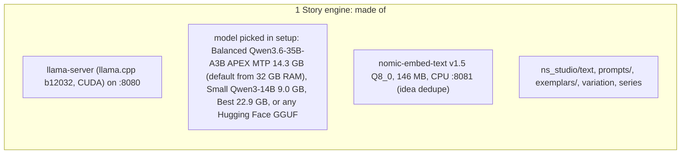

### 2. Voice engine

Reads the script aloud in the channel's voice, all sentences in one batch. Stitches the pieces with set pauses and evens out the loudness.

- **In → out:** `story.json sentences + cliff lines + pacing speed → audio\<id>.wav per chapter and per Short hook`
- **Runs on:** Partner PC GPU. CI: FakeTts tone bursts
- **Talks to:** 1 7 3

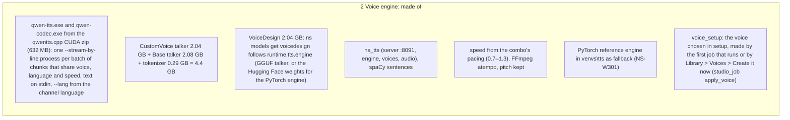

### 3. Ear

Listens to the narration, or to the owner's video, and times every word. Lines the captions up with the script's own spelling.

- **In → out:** `WAV → words\<id>.json, captions\<id>.ass (median caption-to-speech offset ≤ 120 ms, else NS-E403; whisper failure NS-E408)`
- **Runs on:** Partner PC GPU. CI: FakeTranscriber
- **Talks to:** 2 4 7

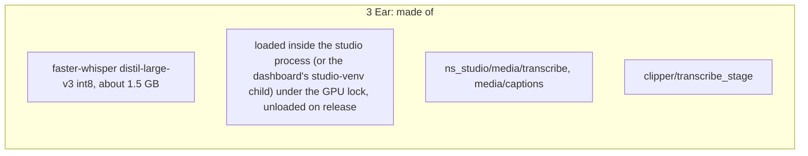

### 4. Picture engine

Turns the visual plan into shots: finds footage, picks clips under reuse rules, lays out the frame. Renders the master and the Shorts with FFmpeg and makes the thumbnails.

- **In → out:** `visual plan + audio + captions → long\master.mp4, shorts\s<k>\short.mp4, thumb_1..3.jpg, clips\c<k>.mp4`
- **Runs on:** Partner PC GPU (NVENC). CI: FakeClipSource + libx264
- **Talks to:** 1 3 5 6

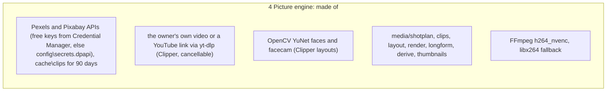

### 5. Judge

Stops anything that is not fit to post. Checks length, loudness, captions, black frames and policy rules, and judges each clip before it is rendered.

- **In → out:** `text and rendered files → qc.json, policy_text.json, policy_final.json; failures go to rejected\`
- **Runs on:** Partner PC. Uses the LLM (fake in CI)
- **Talks to:** 1 4 6

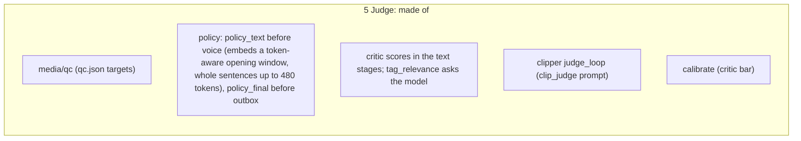

### 6. Memory

Remembers channels, ideas, stories, outputs, clip use, uploads and analytics. Turns YouTube Studio numbers into weights for the next night.

- **In → out:** `finished media, YouTube links, analytics CSV → outbox + upload sheets, pool_weights, cadence plan`
- **Runs on:** Partner PC disk. CI: temporary folders
- **Talks to:** 1 4 8

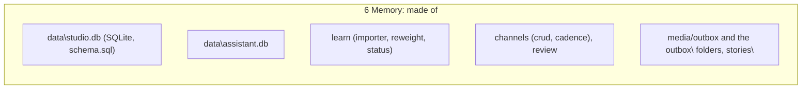

### 7. Conductor

Decides what runs when, and lets only one big model hold the GPU at a time. Starts, stops and cleans up every process, and resumes a job after a crash.

- **In → out:** `a job request → stages in order, GPU tenant swaps, logs`
- **Runs on:** Partner PC. CI: DevAcquirer whenever a model service is faked
- **Talks to:** all

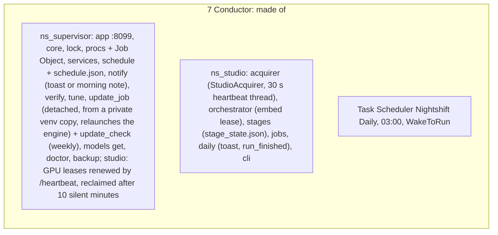

### 8. Face

The window the owner uses: Queue, Create, Library, Channels, Results, Settings. The Assistant, a chat page of its own, can do the same things after the owner says Yes.

- **In → out:** `clicks and chat → jobs, approvals, pasted links, settings`
- **Runs on:** Partner PC. CI: fake supervisor and adapters
- **Talks to:** 7 1 6

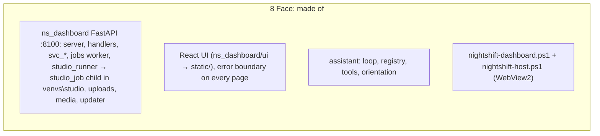

### 9. Installer

Takes a clean PC to a working studio in about an hour. Checks the PC, asks the choices (model picker included), downloads 16–21 GB, verifies, creates the shortcuts and the 03:00 task.

- **In → out:** `zip + answers → NIGHTSHIFT_HOME (models, bin, venvs, config), shortcuts, task, diagnostics zip`
- **Runs on:** Partner PC. CI: --simulate downloads
- **Talks to:** 7 + smoke tests of 1–4

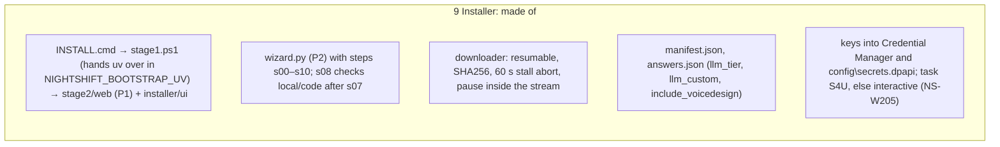


## Plumbing

### a. Ports and start-up

```mermaid
flowchart LR
  A1["1 Desktop shortcut (.lnk → powershell)"] --> A2["2 GET :8099/status (Test-NsSupervisor)"]
  A2 -->|down| A3["3 venvs\supervisor python -m ns_supervisor.app (minimized)"]
  A3 --> A4["4 poll every 500 ms, up to 90 s"]
  A2 -->|up| A7
  A4 --> A5["5 lifespan: Job Object + monitor task"]
  A5 --> A6["6 warmup(dashboard): python -m ns_dashboard.server :8100"]
  A6 --> A7["7 launcher polls :8100 up to 60 s"]
  A7 --> A8["8 nightshift-host.ps1 (exit 3 → Edge/Chrome --app → browser)"]
  A8 --> A9["9 StaticFiles at / (React build)"]
  A9 --> A10["10 GET /api/events (SSE)"]
```

| Process | Port | Speaks |
|---|---|---|
| ns_supervisor.app | 8099 | /health /status /acquire /release /heartbeat /release_owner /stop_all /shutdown /warmup, GET+POST /events |
| ns_dashboard.server | 8100 | React UI at /, JSON under /api, SSE |
| llama-server.exe | 8080 | POST /v1/chat/completions (response_format json_schema), GET /health |
| llama-server.exe --embeddings | 8081 | POST /v1/embeddings (CPU) |
| ns_tts.server | 8091 | POST /v1/audio/speech/batch, /v1/audio/speech, /v1/voices, /v1/voices/design, /v1/voices/clone; runs one qwen-tts.exe --stream-by-line process per batch of chunks sharing voice, language and speed (text on stdin) |
| faster-whisper | none | in-process, GPU lock only |

### b. GPU tenant swap

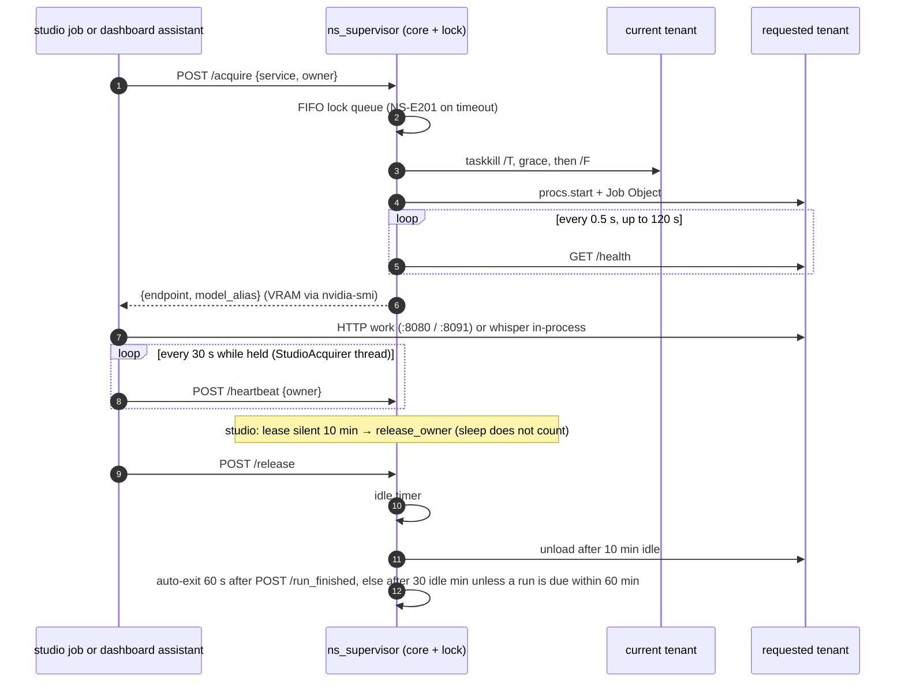

`studio run` (and the 03:00 run) asks through `StudioAcquirer` (`ns_studio/acquirer.py:51`): it starts the engine if it is down and waits up to 2 h for a busy GPU, and renews a held lease every 30 s. Stages that embed text hold `embed` while they run and send whole sentences up to 480 tokens (`embed_window`); the embed service starts with `-c 2048 -b 2048 -ub 2048`. Dashboard Cancel sets a flag the child checks between stages, kills the tree, then sends `POST /release_owner`; the Queue's Release button does the same for whoever holds the GPU.

### c. Story engine internals

```mermaid
flowchart LR
  C1["1 approved idea from the bank, else ideas prompt n=8"] --> C2["2 embed, drop cosine ≥ 0.85"]
  C2 --> C3["3 prompts\<name>.md: front-matter version/thinking/schema"]
  C3 --> C4["4 system + Jinja2 user (split at ---USER---)"]
  C4 --> C5["5 channel, combo, policy_rules, ≤ 3 exemplars"]
  C5 --> C6["6 /v1/chat/completions, response_format json_schema, temp 0.8, ctx 16384"]
  C6 --> C7["7 repair once if JSON fails (temp 0.2) else NS-E302"]
  C7 --> C8["8 pydantic model (ns_common.models)"]
  C8 --> C9["9 critic: avg ≥ critic_bar 8.0 and min ≥ 6"]
  C9 -->|fail| C10["10 revise, at most 2, then NS-E304"]
  C10 --> C9
```

### d. Voice engine internals

```mermaid
flowchart LR
  D1["1 sentences"] --> D2["2 chunks: merge < 25 chars, split > 280"]
  D2 --> D3["3 POST /v1/audio/speech/batch"]
  D3 --> D4["4 one qwen-tts --stream-by-line per batch, split on RIFF headers, 24 kHz"]
  D4 --> D5["5 atempo to the pacing speed, trim at -45 dBFS"]
  D5 --> D6["6 stitch, no crossfade: 120/350/700/1200 ms"]
  D6 --> D7["7 audio\<id>.wav"]
  D7 --> D8["8 loudnorm -16 LUFS (media/voice.py)"]
  D8 --> D9["9 duration_check"]
  D9 --> D10["10 render mix -14 LUFS, AAC 192k"]
```

Voices: 9 CustomVoice presets; designed or cloned voices in `models\tts\voices\<name>\${B}: `voice.json` + `speaker.spk` + `speaker.rvq` + `ref.txt` (qwentts) or `speaker.bin` (PyTorch). Speed comes from the combo's pacing (`ns_common/pacing.py`); `--lang` from the channel language. A voice chosen in setup waits in `config\pending_voice.json` until the first job (`run_job_guarded`) or Library > Voices > Create it now (`apply_voice`) makes it. `ns models get voicedesign` fetches the files the configured engine needs.

### e. Ear and captions

```mermaid
flowchart LR
  E1["1 chapter WAV"] --> E2["2 faster-whisper word_timestamps, VAD"]
  E2 --> E3["3 normalise tokens"]
  E3 --> E4["4 difflib SequenceMatcher align"]
  E4 --> E5["5 drift ≤ 120 ms and match ≥ 0.6, else NS-E403"]
  E5 --> E6["6 words\<id>.json"]
  E6 --> E7["7 caption_styles.yaml, contrast ≥ 4.5"]
  E7 --> E8["8 optional profanity mask (text only)"]
  E8 --> E9["9 ASS, 2-4 words, active word"]
  E9 --> E10["10 FFmpeg ass= burn-in"]
```

### f. Picture engine internals

```mermaid
flowchart LR
  F1["1 visual_plan_long beats"] --> F2["2 shotplan slots"]
  F2 --> F3["3 dedupe keywords"]
  F3 --> F4["4 Pexels 180/h, Pixabay 90/min"]
  F4 --> F5["5 cache\clips 90 days"]
  F5 --> F6["6 pick: reuse 14 d / 30 d"]
  F6 --> F7["7 filter graph: scale, crop, blur fill, zoompan, grade, ass="]
  F7 --> F8["8 h264_nvenc, fallback libx264 (NS-W401)"]
  F8 --> F9["9 render_master, shorts_derive"]
  F9 --> F10["10 thumbnails 1280×720"]
```

### g. Jobs and data

```mermaid
flowchart LR
  G1["1 POST /api/jobs/run"] --> G2["2 dashboard_jobs row (studio.db)"]
  G2 --> G3["3 one FIFO worker thread"]
  G3 --> G4["4 venvs\studio python -m ns_dashboard.studio_job (NSJOB lines)"]
  G4 --> G5["5 data\jobs\<job_id>\ + stage_state.json"]
  G5 --> G6["6 stages write idea.json … qc\report.json"]
  G6 --> G7["7 outbox\<channel>\stories\<title>\full|shorts + sheets"]
  G7 --> G8["8 outputs: pending → approved / rejected / uploaded"]
  G8 --> G9["9 POST /outputs/{id}/uploaded"]
  G9 --> G10["10 CSV → analytics → pool_weights"]
```

Job kinds: run, clip, learn, verify, series_part. The child runs `studio_bridge`; `tests/test_dashboard_wiring.py` resolves every studio name it takes and `tests/test_api_ui_contract.py` checks every route the UI calls against `ui/src/lib/types.ts`. Publish slots come from `<job>\outbox\manifest.json`. Settings > Keys writes Credential Manager and `config\secrets.dpapi`. `schedule.json` exists only for a registered task; `/api/status` sends `schedule_registered`. `ns update` runs from a private copy of `venvs\supervisor` and relaunches the engine (and the window) before it writes `done`.

### h. Assistant plumbing

```mermaid
sequenceDiagram
  autonumber
  participant UI as Assistant page
  participant Loop as assistant.loop
  participant Sup as supervisor :8099
  participant LLM as llama-server :8080
  participant H as dashboard handlers
  UI->>Loop: POST /api/assistant/chat (SSE back)
  Loop->>Sup: GET /status (busy → queued_messages)
  Loop->>Sup: /acquire llama, owner dashboard:assistant
  Loop->>LLM: chat with tools (registry.openai_tools), temp 0.3, ≤ 8 steps
  LLM-->>Loop: tool_call
  alt read-only tool
    Loop->>H: run handler in-process
  else side-effect tool
    Loop-->>UI: confirm card (actions row pending)
    UI->>Loop: POST /api/assistant/confirm
    Loop->>H: run handler
  end
  H-->>Loop: result
  Loop-->>UI: reply
  Loop->>Sup: /release llama
```


## 1. Ship and install

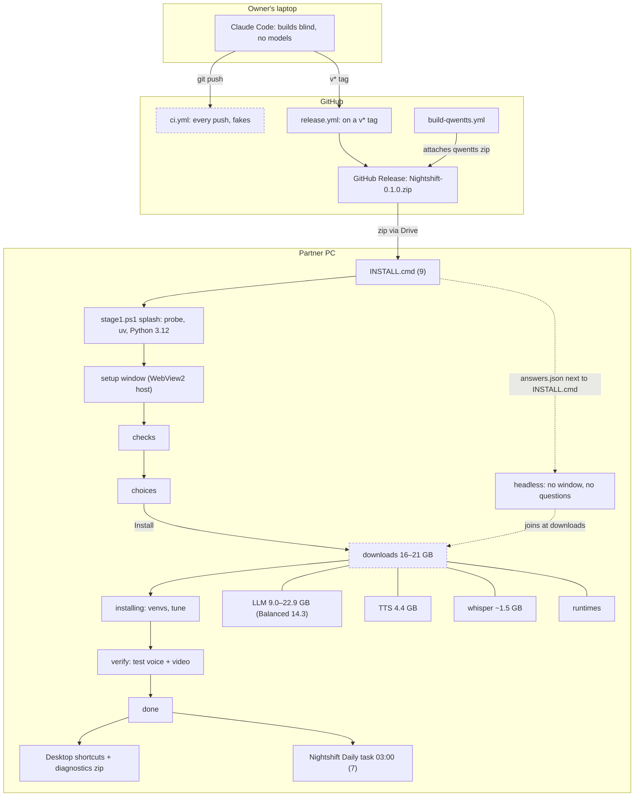

## 2. Runtime process model

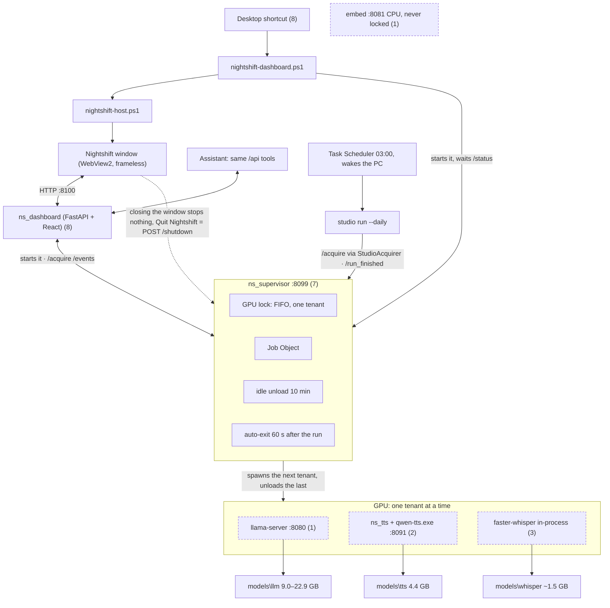

## 3. The nightly pipeline (one master-first video)

```mermaid
flowchart LR
  P1["idea bank · ideas (1 6)"]:::fake --> P2["outline · long_plan (1)"]:::fake --> P3["draft · chapters_draft (1)"]:::fake
  P3 --> P4["critic + revise · chapters_critic, continuity (1 5)"]:::fake --> P5["titles + Shorts pick · seo_long, shorts_select, seo_shorts (1)"]:::fake
  P5 --> P6["visual plan · visual_plan_long (1)"]:::fake --> P7["text gate · policy_text (5)"]:::fake
  P7 --> P8["narration · voice, chunked (2)"]:::fake --> P9["length check · duration_check (2)"]
  P9 --> P10["transcribe + align · captions (3)"]:::fake --> P11["Shorts timing · shorts_timing (3)"]
  P11 --> P12["clip search · clips, Pexels/Pixabay (4)"]:::fake --> P13["render master · render_master, NVENC (4)"]:::fake
  P13 --> P14["thumbnails (4)"] --> P15["derive Shorts · shorts_derive (4)"]:::fake
  P15 --> P16["QC gates · qc, fail → rejected (5)"] --> P17["final gate · policy_final (5)"]:::fake
  P17 --> P18["outbox · outbox\<channel>\stories\<title>\ (6)"] --> P19["Ready to review · Queue (8)"]
  P19 --> H1(["owner approves"]) --> H2(["posts on YouTube by hand"]) --> H3(["pastes the link · Mark uploaded (8)"])
  H3 --> P20["learning loop · CSV → pool_weights (6)"]
  P20 -->|weights steer the next night| P1
  classDef fake stroke-dasharray: 4 3;
```

Dashed = a fake stands in for it in CI (FakeLlm, FakeTts, FakeTranscriber, FakeClipSource, libx264).

## 4. Clipper and Series Workshop

```mermaid
flowchart LR
  subgraph CL["Clipper (format clip)"]
    V1["own video file (rights confirmed)"] --> C1
    V2["YouTube link · yt-dlp (4)"] --> C1
    C1["clip_import + clip_audio (4)"] --> C2["clip_analyze: scenes, loudness, faces (4)"] --> C3["clip_transcribe (3)"]:::fake
    C3 --> C4["clip_select: LLM picks, judge per clip (1 5)"]:::fake --> C5["clip_layout: model-chosen (1 4)"]
    C5 --> C6["clip_captions (3)"] --> C7["clip_render NVENC 1080×1920 (4)"]:::fake --> C8["clip_seo + clip_qc (5)"]:::fake
    C8 --> C9["outbox\<ch>\clips\<source>\ (6)"]
  end
  subgraph SW["Series Workshop (stories\<slug>\)"]
    W1["workshop_start · concept.md"] --> W2["concepts A–C, choose"] --> W3["workshop_map · series.md"]
    W3 --> W4["write parts · script.md + shorts\s*.md"] --> W5["approve + design.yaml"]
    W5 --> W6["workshop_produce: one job per part"] --> W7["script_import (replaces ideas → critic)"]
    W7 --> W8["same pipeline from visual plan on"] --> W9["outbox\<ch>\series\<slug>\part-NN\ (6)"]
  end
  C9 --> R["Ready to review (8)"]
  W9 --> R
  classDef fake stroke-dasharray: 4 3;
```

